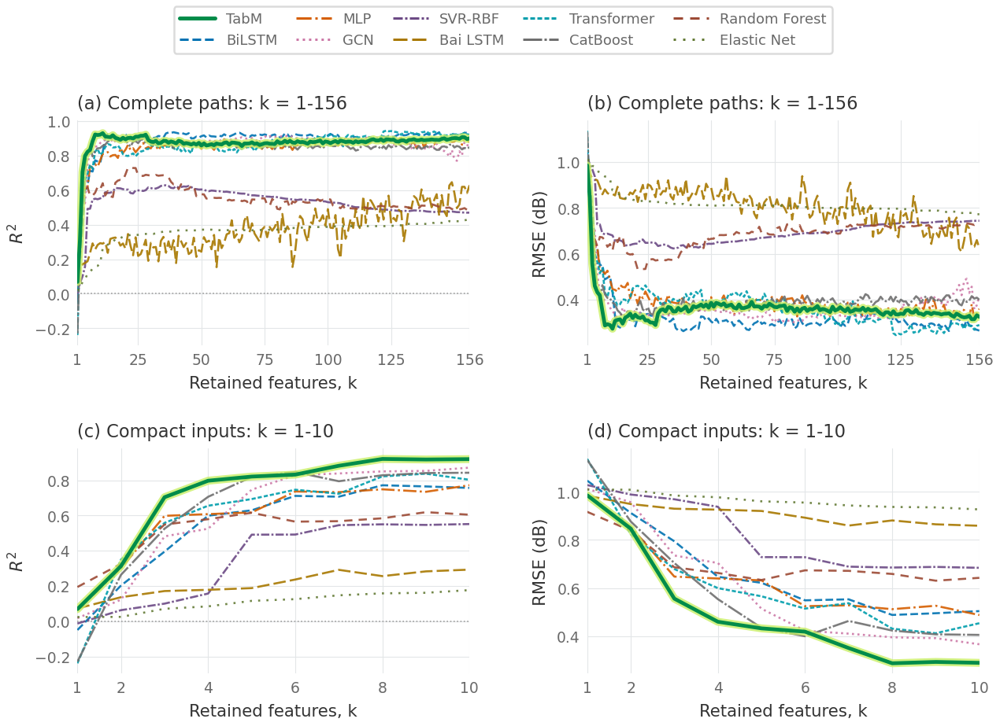
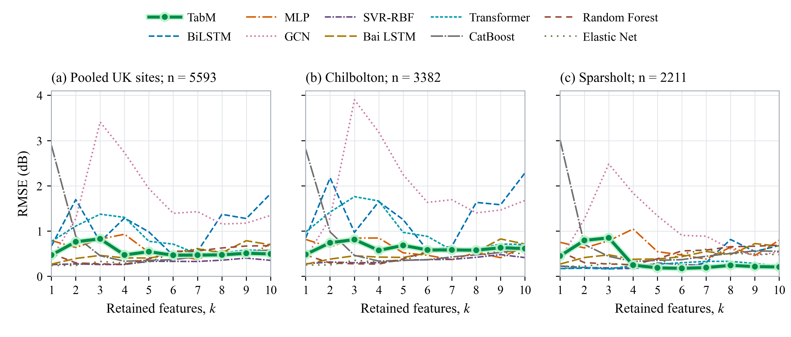

# Supplementary material for VT-2026-03463

This private repository contains the scientific code, configurations, aggregate
results, figures, editable diagrams, and UK observations supporting the revised
Ka-band satellite-channel manuscript. **The local measurement dataset is not
distributed in this repository, at the author's request.**

## What is included

| Material | Location | Availability |
|---|---|---|
| Ten-model 156-to-1 RFE code; independent TabM 50-to-1 run | `src/hourly/`, `src/reference_project/Code/Hourly_Attenuation_Experiments/` | Included |
| All 1,610 states: ordered inputs, deletions, configuration, fold and epoch metrics | `results/tables/rfe_state_summaries/` and `results/logs/release_verification_001/` | Aggregate-only summaries; individual local rows removed |
| Frozen model artifacts | Historical `fits/`, `models/` and `fold_models/` directories under `results/tables/reference_project/` | Models referenced by the summaries, except SVR support-vector artifacts |
| CEDA Chilbolton/Sparsholt station-day files and UK ERA5 payloads | `data/raw/ceda/`, `data/raw/era5/uk/` | Included |
| UK input table and predictions of the 100 frozen states | `results/tables/reference_project/Outputs/Experiments/Hourly_Attenuation_Revision_037_UK_Frozen_RFE/` | Included, including recorded SVR predictions |
| Second-scale generator, date-fold selection, CRPS, ACF, duration and combination evaluation code | `src/fast/`, `src/evaluation/`, archived scientific code | Included |
| Latest 32-realization statistics and paper tables | `results/tables/figure_inputs/common/`, `results/tables/manuscript/` | Aggregate results included |
| Figure code and editable architecture diagrams | `figsrc/` | Included |

The **local raw and processed power/attenuation series, local ERA5 values, split
rows, local prediction/observation pairs, SHAP background/test inputs, and measured
CDF samples/segment libraries are omitted**. SVR fitted artifacts are omitted
because their support vectors contain local training samples. Local observation
sequence figures and their numerical sources are also omitted. Aggregated model
performance and temporal-statistics figures remain available. The original local
supplementary package is unchanged.

## Quick start

**Hardware and environment.** Python 3.12; CPU execution using two threads; no GPU
is required. Install `requirements.txt` in an existing suitable environment.
Windows is the verified platform. Git Bash can run the shell commands on Windows.
The original full experimental workflow recommends 16 GB RAM and 100 GB free
disk for a complete new run; these are planning figures, not measured minima.
Set `PYTHON` to the desired Python interpreter if necessary.

**Review and redraw the distributed results:**

```bash
bash scripts/make_figures.sh
```

This redraws the ten-model RFE, equal-dimension TabM comparison, UK evaluation,
and ACF/fade-duration figures from the included numerical results, without
training. Each run writes to a new timestamped folder under `results/figures/`
and records its log under `results/logs/`. Editable architecture drawings and
their publication PDFs are also included. SHAP summary figures and rankings are
provided; recalculating local SHAP requires the omitted local inputs.

**Full training and evaluation, after separately restoring the author's local
inputs into their original package-relative locations:**

```bash
bash scripts/run_all.sh
```

The command checks for the missing local inputs before starting. This filtered
repository alone does **not** support a complete fresh local retraining or frozen
generator replay. The scientific implementation is preserved; the publication
snapshot does not replace missing data with synthetic values or UK observations.
The full 1,610-state retraining has not been timed end to end, so no completion
time is promised. Elapsed time is recorded by the runnable figure workflow.

## Figure-to-source mapping

| Output | Entry script | Distributed numerical source |
|---|---|---|
| Ten-model RFE | `figsrc/plot_fig06_rfe.py` | `common/frozen_exports/local_metrics.csv` |
| Independent stratified/non-stratified TabM RFE runs | `figsrc/plot_fig07_independent_rfe.py` | `common/frozen_exports/tabm_same_k.csv` |
| UK frozen-model comparison | `figsrc/plot_fig08_uk.py` | `common/frozen_exports/uk_metrics.csv` and UK prediction parquet |
| ACF and fade-duration distributions | `figsrc/plot_fig10_fast_temporal.py` | `common/Fig10_dense_acf_1_to_1800.csv`, `common/Fig10_duration_distributions.csv` |
| Atmosphere and TabM diagrams | `figsrc/plot_fig02_atmosphere.py`, `figsrc/plot_fig05_tabm.py` | Editable PPTX under `figsrc/editable/`; verified PDFs under `results/figures/published/` |

`common/` above is within `results/tables/figure_inputs/`. Original asset IDs are
retained; they need not equal the printed figure numbers in every manuscript draft.





## Data sources and rights

See [data/raw/README.md](data/raw/README.md) for provider identifiers and optional
official download commands. No credentials, temporary signed download links or
access tokens are part of this release. Original third-party terms and bundled
dependency licence notices remain applicable; private repository visibility does
not grant permission to relicense those materials. No new blanket licence is
assigned to the data or software in this upload.

## Traceability and integrity

- `config.yaml` preserves the published configuration, primary seed 17, and
  separately named historical random seeds.
- `results/logs/UPLOAD_SCOPE.json` states exactly which classes were included or
  omitted.
- `results/logs/DERIVED_ARTIFACTS.json` maps each aggregate RFE summary to its
  source state. These summaries are explicitly **not** resumable original state
  files; local sample arrays were intentionally removed.
- `results/logs/release_verification_001/all_retained_and_removed_features.csv`
  records the retained and removed features for every iteration.
- `results/logs/release_verification_001/all_local_metrics.csv` contains the
  saved local train/validation/test aggregate scores.
- `results/logs/UPLOAD_FILES.jsonl` records SHA-256 for the delivered files.
- Historical catalogues under `results/logs/provenance/` describe the complete
  local experiment. This README and `UPLOAD_SCOPE.json` take precedence for
  availability in the filtered GitHub distribution.

## 中文说明

本仓库按作者要求不上传本地数据集，也排除了夹带本地实测值的中间文件。
英国两站数据、代码、每轮特征筛选与汇总指标、论文统计图和可编辑架构图保留。
本地快变经验分布与实测片段库未上传，不能宣称仅凭此仓库即可完整重跑本地实验。
`make_figures.sh` 可重绘已提供数据的四组统计图；完整训练需另行恢复本地输入。

## Download the larger frozen artifacts

The repository tree contains code, UK data and browsable result tables. Frozen
models and the 1,610 aggregate per-state/epoch summaries are attached to the
[private release](https://github.com/hasstar/TVT-2026-03463-SupplementaryMaterial/releases/tag/supplementary-20261106).
They are split into independent ZIP files; extract all of them into the clone
root, keeping the archived paths. The release manifest gives sizes and SHA-256.

With GitHub CLI authenticated to an account that can access this private repo:

```bash
gh release download supplementary-20261106 --repo hasstar/TVT-2026-03463-SupplementaryMaterial --pattern '*.zip' --dir downloads
python scripts/restore_release.py --archives downloads
```

The restore script verifies the archives and refuses to overwrite a different
existing file. Restoring the release does not restore the unpublished local
dataset or SVR support vectors. The aggregate-only state summaries cannot be
used as substitutes for original resumable training checkpoints.

The four distributed figure groups were redrawn successfully in 34.9 seconds
on the existing release-check machine. This excludes dependency installation
and is not a full training runtime estimate.
