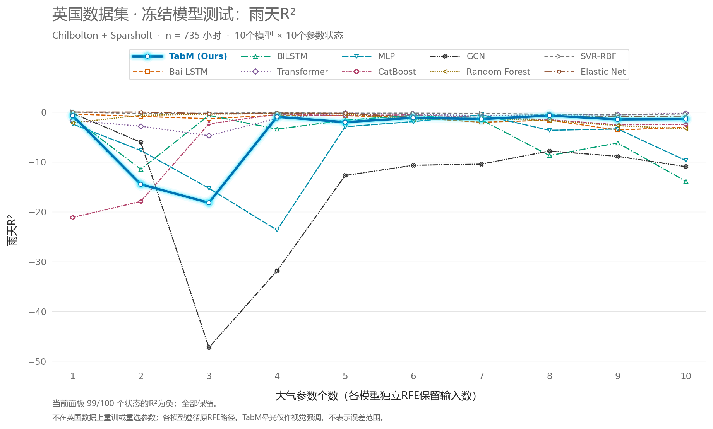
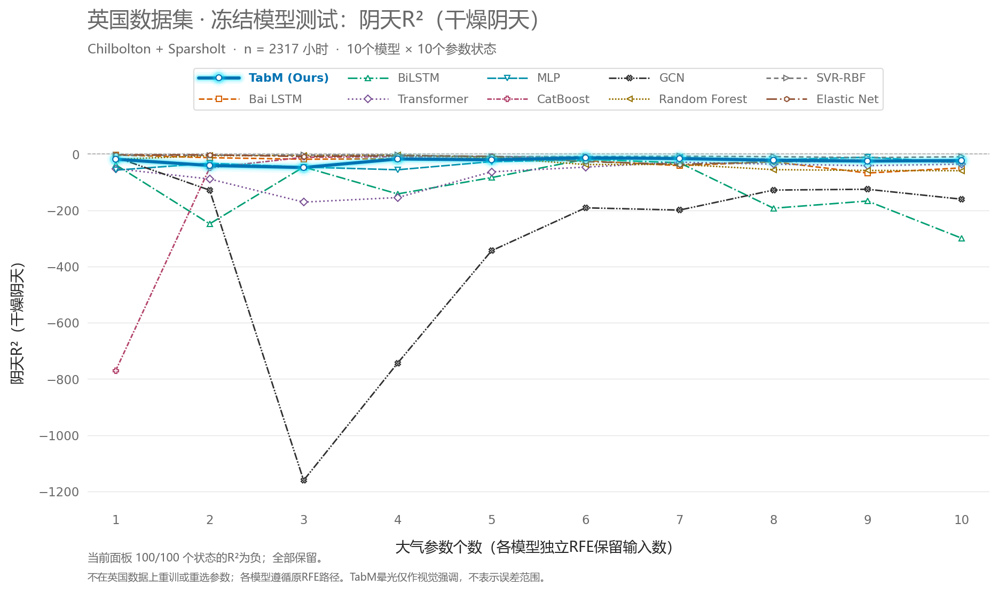
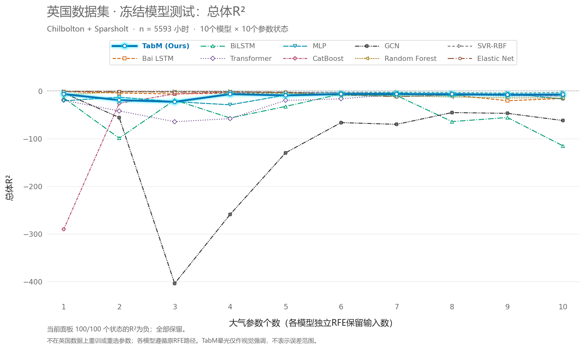
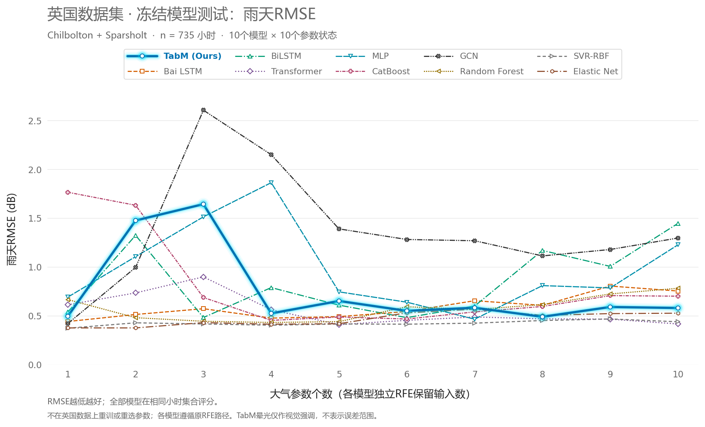
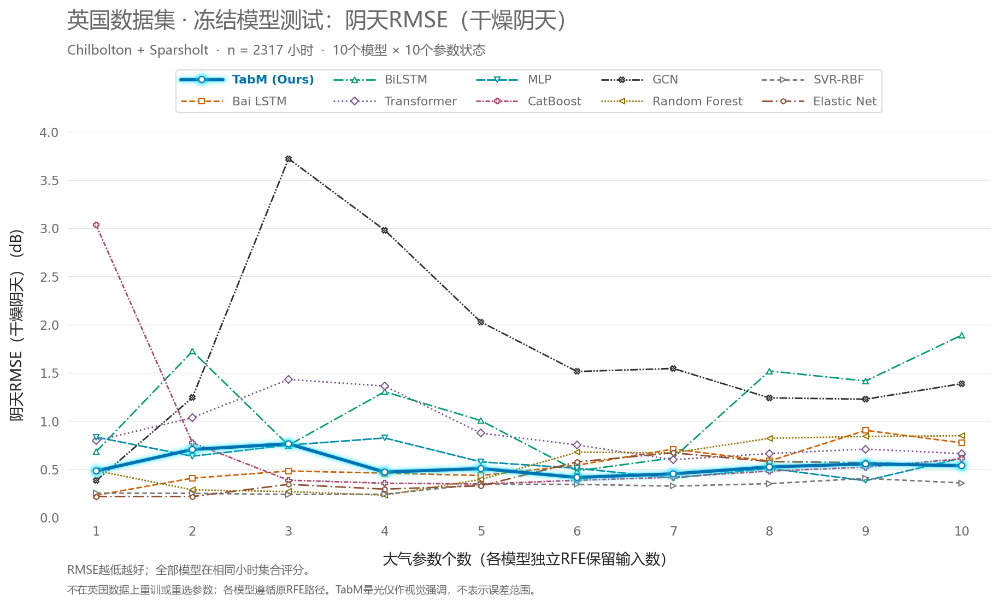
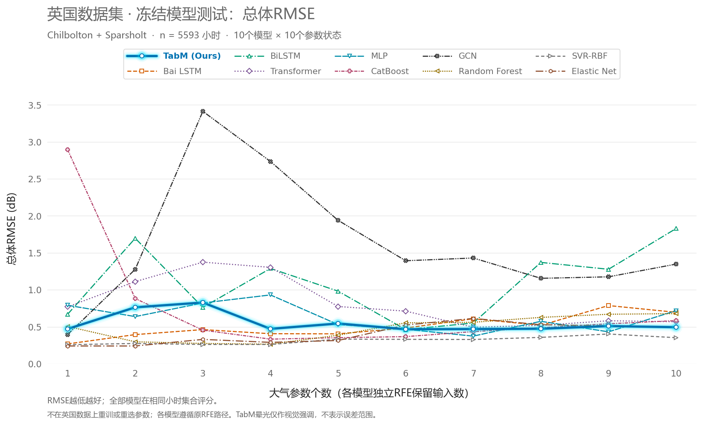

# 英国数据集：10模型冻结RFE 10→1输入测试

已完成100个冻结状态的数值测试，独立输入QA、LOCAL预测重放和独立指标QA通过。六张图已导出；最终人工视觉检查尚待完成，不能将本文件等同于全部交付完成。

## 测试口径

- 10模型均沿用各自LOCAL独立RFE的10→1输入和原训练权重、预处理器、配置及种子17。没有英国重训、预处理重拟合、英国删列、选种子或测试调参。
- 英国Chilbolton和Sparsholt共236站点日、5664小时；沿用既有71小时质量排除，所有模型总体均为5593小时，雨天735小时，干燥阴天2317小时。总体包含other，不按模型成绩或天气额外删样本。
- R²=1−SSE/SST，为决定系数，不是相关系数平方；负值完整保留。RMSE单位dB。
- 每条曲线按各模型自己的输入路径排列，k相同不代表气象参数相同。横坐标1→10仅为显示顺序，原RFE方向156→1。
- 英国标签沿用GBS 20.7 GHz原生标签−10log10(小时平均线性透射率)；没有重估CDF、拟合偏移或裁零。该英国集合过去已查看，不声称首次盲测。
- 压力层保持既有视线取样约定：1 hPa复用已核验逐小时几何，其他层使用原有标准大气固定高度近似。新增层是同一近似的延伸，不是观测逐小时高度。
- 补采只覆盖现有站点/日期：24项NCAR精确子集，K指数、Total totals指数和降水类型使用已授权官方CDS；旧下载队列和停止标记未改。

## 文件

- 完整六指标表：[UK_100_states_six_metrics.csv](evaluation/UK_100_states_six_metrics.csv)
- 天气、站点、样本数和实际日期：[metrics_all_weather_station.csv](evaluation/metrics_all_weather_station.csv)
- 所有状态输入顺序：[retained_inputs_all_100_states.csv](evaluation/retained_inputs_all_100_states.csv)
- 逐小时预测：[all_hourly_predictions.parquet](evaluation/all_hourly_predictions.parquet)
- 输入来源与SHA：[new_field_provenance.parquet](inputs/new_field_provenance.parquet)
- 冻结权重及路径：[frozen_states_100.json](frozen_states_100.json)

## 六张图

每图10条原始折线，TabM加粗并带青色荧光；荧光不表示误差带。没有平滑或隐藏负R²。不同面板采用覆盖全部数据的纵轴范围。

## TabM（本文模型）

| 参数数 | 雨天R² | 阴天R² | 总体R² | 雨天RMSE | 阴天RMSE | 总体RMSE |
|---:|---:|---:|---:|---:|---:|---:|
| 10 | -1.393517 | -23.289372 | -7.504781 | 0.580208 | 0.538019 | 0.494579 |
| 9 | -1.478646 | -24.967586 | -8.038785 | 0.590436 | 0.556295 | 0.509869 |
| 8 | -0.706952 | -22.070444 | -6.811026 | 0.489978 | 0.524345 | 0.473978 |
| 7 | -1.414084 | -16.217788 | -6.672103 | 0.582696 | 0.452979 | 0.469744 |
| 6 | -1.155351 | -13.500406 | -6.575144 | 0.550585 | 0.415700 | 0.466766 |
| 5 | -2.022689 | -20.619354 | -9.314552 | 0.652022 | 0.507587 | 0.544665 |
| 4 | -0.959639 | -17.644043 | -6.758004 | 0.524993 | 0.471367 | 0.472366 |
| 3 | -18.205473 | -48.018924 | -22.852857 | 1.643532 | 0.764313 | 0.828274 |
| 2 | -14.495084 | -40.755695 | -19.257425 | 1.476259 | 0.705419 | 0.763301 |
| 1 | -0.745349 | -18.546041 | -6.707705 | 0.495458 | 0.482635 | 0.470833 |

## Bai LSTM

| 参数数 | 雨天R² | 阴天R² | 总体R² | 雨天RMSE | 阴天RMSE | 总体RMSE |
|---:|---:|---:|---:|---:|---:|---:|
| 10 | -3.040283 | -49.362823 | -15.839845 | 0.753827 | 0.774720 | 0.695942 |
| 9 | -3.604796 | -67.549199 | -20.548389 | 0.804768 | 0.903838 | 0.787248 |
| 8 | -1.619957 | -27.784565 | -8.427264 | 0.607034 | 0.585692 | 0.520711 |
| 7 | -2.047526 | -41.253491 | -11.883375 | 0.654696 | 0.709612 | 0.608722 |
| 6 | -1.105565 | -23.738643 | -7.125555 | 0.544189 | 0.542972 | 0.483426 |
| 5 | -0.720097 | -14.918426 | -4.697646 | 0.491861 | 0.435552 | 0.404810 |
| 4 | -0.614490 | -16.821162 | -4.750662 | 0.476522 | 0.460848 | 0.406689 |
| 3 | -1.333744 | -18.492749 | -6.431794 | 0.572918 | 0.481977 | 0.462329 |
| 2 | -0.877431 | -12.990960 | -4.419329 | 0.513863 | 0.408332 | 0.394800 |
| 1 | -0.387784 | -3.461996 | -1.516591 | 0.441801 | 0.230597 | 0.269036 |

## BiLSTM

| 参数数 | 雨天R² | 阴天R² | 总体R² | 雨天RMSE | 阴天RMSE | 总体RMSE |
|---:|---:|---:|---:|---:|---:|---:|
| 10 | -13.885139 | -299.082642 | -115.260388 | 1.446912 | 1.891080 | 1.828605 |
| 9 | -6.197700 | -167.208277 | -55.778973 | 1.006149 | 1.415837 | 1.277902 |
| 8 | -8.724809 | -192.712952 | -64.307785 | 1.169516 | 1.519388 | 1.370523 |
| 7 | -1.559577 | -31.087449 | -9.576955 | 0.599998 | 0.618382 | 0.551549 |
| 6 | -0.648241 | -18.612286 | -6.420539 | 0.481477 | 0.483452 | 0.461978 |
| 5 | -1.639220 | -83.795383 | -32.547908 | 0.609261 | 1.005253 | 0.982283 |
| 4 | -3.427642 | -141.861715 | -56.754177 | 0.789136 | 1.304810 | 1.288830 |
| 3 | -0.655711 | -46.090883 | -19.237980 | 0.482567 | 0.749131 | 0.762935 |
| 2 | -11.467118 | -248.422718 | -99.078298 | 1.324185 | 1.724080 | 1.696578 |
| 1 | -1.057220 | -38.167052 | -14.583544 | 0.537906 | 0.683203 | 0.669479 |

## Transformer

| 参数数 | 雨天R² | 阴天R² | 总体R² | 雨天RMSE | 阴天RMSE | 总体RMSE |
|---:|---:|---:|---:|---:|---:|---:|
| 10 | -0.233865 | -35.921769 | -10.232298 | 0.416581 | 0.663332 | 0.568379 |
| 9 | -0.545506 | -41.239116 | -10.777429 | 0.466231 | 0.709491 | 0.582008 |
| 8 | -0.565710 | -35.912853 | -8.372424 | 0.469268 | 0.663252 | 0.519194 |
| 7 | -0.694986 | -29.177184 | -7.488702 | 0.488257 | 0.599693 | 0.494111 |
| 6 | -0.465792 | -46.554792 | -16.635199 | 0.454048 | 0.752812 | 0.712187 |
| 5 | -0.194788 | -63.270124 | -19.853449 | 0.409931 | 0.875173 | 0.774449 |
| 4 | -1.249239 | -154.874992 | -58.107728 | 0.562449 | 1.362943 | 1.303845 |
| 3 | -4.743997 | -171.002618 | -64.625661 | 0.898820 | 1.431716 | 1.373855 |
| 2 | -2.837786 | -88.835307 | -41.905908 | 0.734693 | 1.034697 | 1.110868 |
| 1 | -1.673337 | -52.227221 | -19.626488 | 0.613186 | 0.796446 | 0.770223 |

## MLP

| 参数数 | 雨天R² | 阴天R² | 总体R² | 雨天RMSE | 阴天RMSE | 总体RMSE |
|---:|---:|---:|---:|---:|---:|---:|
| 10 | -9.710908 | -30.964302 | -16.917483 | 1.227379 | 0.617195 | 0.717864 |
| 9 | -3.390808 | -11.233020 | -5.487905 | 0.785847 | 0.381818 | 0.431973 |
| 8 | -3.656587 | -20.719671 | -10.472718 | 0.809281 | 0.508764 | 0.574430 |
| 7 | -0.541063 | -13.023943 | -3.866930 | 0.465560 | 0.408813 | 0.374138 |
| 6 | -1.908888 | -20.843034 | -6.568327 | 0.639630 | 0.510206 | 0.466556 |
| 5 | -2.949858 | -26.987379 | -8.793791 | 0.745343 | 0.577525 | 0.530737 |
| 4 | -23.692693 | -56.034111 | -29.132138 | 1.863588 | 0.824436 | 0.930934 |
| 3 | -15.285067 | -46.323248 | -22.510713 | 1.513423 | 0.750977 | 0.822312 |
| 2 | -7.700551 | -32.943213 | -13.167810 | 1.106214 | 0.636013 | 0.638345 |
| 1 | -2.398651 | -57.320534 | -20.747777 | 0.691383 | 0.833682 | 0.790881 |

## CatBoost

| 参数数 | 雨天R² | 阴天R² | 总体R² | 雨天RMSE | 阴天RMSE | 总体RMSE |
|---:|---:|---:|---:|---:|---:|---:|
| 10 | -2.493793 | -30.154786 | -10.841255 | 0.700994 | 0.609329 | 0.583583 |
| 9 | -2.552949 | -21.905520 | -9.174126 | 0.706903 | 0.522468 | 0.540944 |
| 8 | -1.523332 | -18.494340 | -7.269747 | 0.595735 | 0.481996 | 0.487697 |
| 7 | -1.074417 | -13.669402 | -5.581587 | 0.540149 | 0.418115 | 0.435080 |
| 6 | -0.553058 | -11.493291 | -3.692227 | 0.467369 | 0.385858 | 0.367361 |
| 5 | -0.691079 | -9.135443 | -3.330192 | 0.487694 | 0.347545 | 0.352905 |
| 4 | -0.461613 | -9.607420 | -2.862963 | 0.453400 | 0.355545 | 0.333322 |
| 3 | -2.362165 | -11.568630 | -6.193950 | 0.687662 | 0.387020 | 0.454870 |
| 2 | -17.937056 | -49.514276 | -26.052436 | 1.632006 | 0.775884 | 0.882078 |
| 1 | -21.158163 | -770.578126 | -290.255338 | 1.765357 | 3.032351 | 2.894282 |

## GCN

| 参数数 | 雨天R² | 阴天R² | 总体R² | 雨天RMSE | 阴天RMSE | 总体RMSE |
|---:|---:|---:|---:|---:|---:|---:|
| 10 | -10.957378 | -160.597556 | -62.151323 | 1.296832 | 1.387736 | 1.347706 |
| 9 | -8.886562 | -125.333267 | -47.054843 | 1.179202 | 1.227011 | 1.175635 |
| 8 | -7.813643 | -128.183114 | -45.428763 | 1.113380 | 1.240773 | 1.155573 |
| 7 | -10.446193 | -199.379515 | -70.109268 | 1.268809 | 1.545312 | 1.430102 |
| 6 | -10.680817 | -191.331146 | -66.473929 | 1.281747 | 1.513960 | 1.393067 |
| 5 | -12.738591 | -344.029005 | -129.825494 | 1.390070 | 2.027763 | 1.939770 |
| 4 | -31.870783 | -743.910767 | -259.082554 | 2.150159 | 2.979488 | 2.735014 |
| 3 | -47.268870 | -1160.861533 | -404.004427 | 2.605549 | 3.721060 | 3.412981 |
| 2 | -6.047800 | -128.537388 | -55.689708 | 0.995617 | 1.242473 | 1.276898 |
| 1 | -0.260272 | -11.266032 | -4.451856 | 0.421015 | 0.382333 | 0.395983 |

## Random Forest

| 参数数 | 雨天R² | 阴天R² | 总体R² | 雨天RMSE | 阴天RMSE | 总体RMSE |
|---:|---:|---:|---:|---:|---:|---:|
| 10 | -3.347007 | -59.359354 | -14.994408 | 0.781917 | 0.848129 | 0.678247 |
| 9 | -2.726608 | -58.301649 | -14.601852 | 0.723973 | 0.840665 | 0.669872 |
| 8 | -1.688340 | -55.573802 | -12.674848 | 0.614905 | 0.821102 | 0.627141 |
| 7 | -1.266268 | -36.751965 | -9.943458 | 0.564575 | 0.670748 | 0.561024 |
| 6 | -1.501487 | -37.483160 | -9.658515 | 0.593150 | 0.677212 | 0.553672 |
| 5 | -0.380090 | -12.067595 | -4.190741 | 0.440575 | 0.394627 | 0.386384 |
| 4 | -0.325993 | -3.497709 | -1.444878 | 0.431853 | 0.231518 | 0.265175 |
| 3 | -0.402601 | -5.067810 | -1.632699 | 0.444153 | 0.268909 | 0.275172 |
| 2 | -0.644233 | -5.885606 | -2.076713 | 0.480892 | 0.286458 | 0.297473 |
| 1 | -2.155423 | -18.792743 | -7.862387 | 0.666184 | 0.485671 | 0.504870 |

## SVR-RBF

| 参数数 | 雨天R² | 阴天R² | 总体R² | 雨天RMSE | 阴天RMSE | 总体RMSE |
|---:|---:|---:|---:|---:|---:|---:|
| 10 | -0.370354 | -9.784938 | -3.332088 | 0.439018 | 0.358508 | 0.352982 |
| 9 | -0.556139 | -12.780415 | -4.637439 | 0.467832 | 0.405248 | 0.402666 |
| 8 | -0.452522 | -9.348524 | -3.435386 | 0.451988 | 0.351179 | 0.357166 |
| 7 | -0.284124 | -7.912556 | -2.755672 | 0.424981 | 0.325905 | 0.328661 |
| 6 | -0.220876 | -8.902801 | -2.797709 | 0.414383 | 0.343533 | 0.330495 |
| 5 | -0.233344 | -9.084423 | -2.857288 | 0.416493 | 0.346669 | 0.333077 |
| 4 | -0.161080 | -3.911045 | -1.369930 | 0.404107 | 0.241923 | 0.261079 |
| 3 | -0.233865 | -3.789774 | -1.375999 | 0.416581 | 0.238917 | 0.261413 |
| 2 | -0.305119 | -4.280604 | -1.626364 | 0.428441 | 0.250860 | 0.274841 |
| 1 | 0.010967 | -4.357349 | -1.317366 | 0.372968 | 0.252676 | 0.258167 |

## Elastic Net

| 参数数 | 雨天R² | 阴天R² | 总体R² | 雨天RMSE | 阴天RMSE | 总体RMSE |
|---:|---:|---:|---:|---:|---:|---:|
| 10 | -0.974093 | -23.858774 | -7.403962 | 0.526926 | 0.544289 | 0.491639 |
| 9 | -0.942775 | -26.120687 | -8.208942 | 0.522729 | 0.568512 | 0.514646 |
| 8 | -0.811248 | -27.208022 | -8.704355 | 0.504725 | 0.579797 | 0.528308 |
| 7 | -1.295376 | -36.745237 | -12.082327 | 0.568189 | 0.670688 | 0.613404 |
| 6 | -1.001174 | -26.886121 | -8.544844 | 0.530528 | 0.576479 | 0.523948 |
| 5 | -0.249962 | -8.052343 | -2.447173 | 0.419290 | 0.328451 | 0.314873 |
| 4 | -0.219737 | -6.272091 | -1.919768 | 0.414189 | 0.294387 | 0.289786 |
| 3 | -0.317127 | -8.901844 | -2.783764 | 0.430407 | 0.343516 | 0.329888 |
| 2 | -0.006809 | -2.954500 | -1.014170 | 0.376304 | 0.217088 | 0.240687 |
| 1 | -0.006861 | -2.958266 | -1.015590 | 0.376314 | 0.217191 | 0.240771 |

## 核验与异常

- 独立指标实现使用math.fsum；校验6000个指标，最大绝对差4.55e-13。
- 重验6855项历史保护文件SHA，全部一致；6240角色槽权重保持原样。
- 原始下载失败、超时和中间文件全部保留；没有以修改旧结果的方式通过QA。
- 已有质量排除理由见原数据exclusion_reason；新增气象负值与范围见inputs/new_field_summary.csv，未经裁零。

图表与表格是描述性跨域比较，不据此重新选择k或宣称等预算调参。完整精度请使用CSV，而非本页六位小数。
